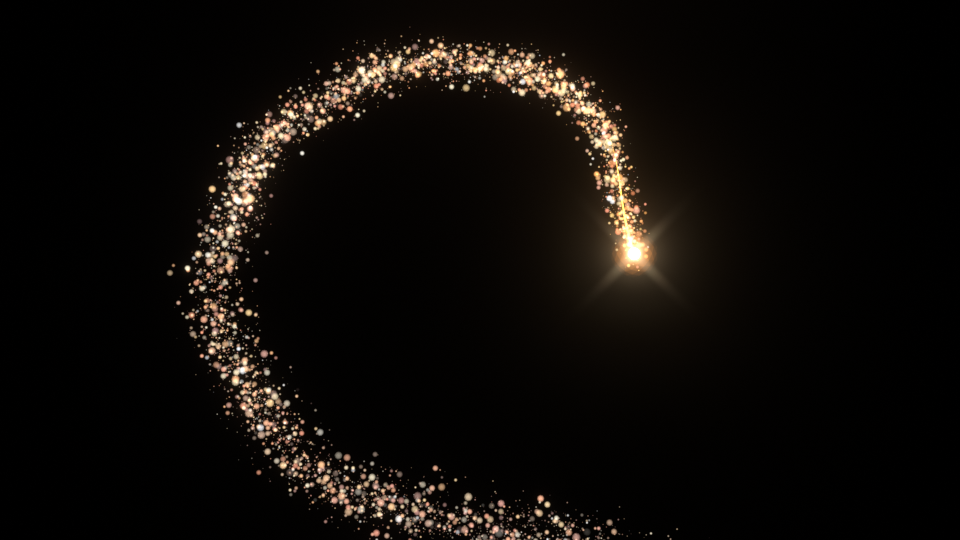

# Leuchtkugel mit Glitzerspur (Blender / EEVEE)

Eine weihnachtliche Leuchtkugel fliegt entlang eines frei formbaren Pfads und
hinterlässt eine glitzernde, langsam herabrieselnde Funkenspur – gerendert auf
Schwarz, wie in der Referenz.



Animierte Vorschau (niedrige Auflösung, jedes 3. Frame): [`preview/vorschau.gif`](preview/vorschau.gif)

| Datei | Inhalt |
|---|---|
| `leuchtkugel_glitzerspur.blend` | fertige Szene, direkt öffnen und rendern (erstellt mit Blender 5.2 LTS) |
| `create_scene.py` | erzeugt die Szene komplett neu (für andere Blender-Versionen oder nach Experimenten) |
| `preview/` | Test-Renders (Frames 40 / 96 / 140) und animierte Vorschau `vorschau.gif` |

## Aufbau der Szene

| Objekt | Funktion |
|---|---|
| **Kugel_Pfad** | Bezier-Kurve – der Flugweg der Kugel (wird nicht gerendert) |
| **Glitzerspur** | Geometry-Nodes-Objekt: erzeugt Kugel, Halo, Leuchtschweif und Funken. **Alle Regler sitzen hier im Modifier-Panel.** |
| **Kamera** | Frontalansicht (blickt entlang +Y), 35 mm |

Alles ist prozedural: Es gibt keine Partikelsimulation und nichts muss gebacken
werden. Pfad ändern oder in der Timeline scrubben aktualisiert die Spur sofort.

## Pfad der Kugel anpassen

1. `Kugel_Pfad` auswählen → **Tab** (Edit Mode).
2. Punkte mit **G** verschieben, mit **E** am Ende neue Punkte anhängen,
   mit **X** löschen. Die Griffe stehen auf *Auto* – der Pfad bleibt automatisch rund.
3. Die Kamera schaut frontal auf die X/Z-Ebene: am besten in der Vorderansicht
   (**Numpad 1**) arbeiten. Y-Tiefe ist erlaubt (die Kugel fliegt dann auf die
   Kamera zu bzw. von ihr weg).
4. Flugrichtung umkehren: im Edit Mode alles auswählen → *Segments → Switch Direction*.

Die Kugel startet am **ersten** Punkt der Kurve und endet am letzten.

## Geschwindigkeit / Timing

Im Objekt `Glitzerspur` → Modifier-Tab (Schraubenschlüssel) → Panel **Pfad & Timing**:

| Regler | Bedeutung |
|---|---|
| **Start Frame** | Frame, an dem die Kugel losfliegt |
| **Ende Frame** | Frame, an dem sie das Pfadende erreicht. Abstand kleiner = schneller |
| **Ease In/Out** | an: weiches Beschleunigen/Abbremsen, aus: konstante Geschwindigkeit |
| **Bildrate** | muss der Szenen-Bildrate entsprechen (Standard 30 fps) |

Beispiel: Start 1, Ende 60 → Flug in 2 s; Start 1, Ende 240 → Flug in 8 s.
Die Gesamtlänge der Animation (Ausklingen der Spur) stellst du wie gewohnt unter
*Output Properties → Frame Range* ein (Standard 1–180). Wenn du die Bildrate der
Szene änderst, trage denselben Wert bei **Bildrate** ein.

Alle Regler lassen sich mit **I** (Mauszeiger darüber) keyframen – z. B. kann
„Helligkeit“ am Ende auf 0 animiert werden.

## Aussehen der Spur

Panel **Kugel**

| Regler | Wirkung |
|---|---|
| Kugel sichtbar | Kugel + Halo ein/aus |
| Kugel Größe / Halo Größe | Kern und weicher Lichthof |
| Schweif Länge / Dicke | dünner, heller Leuchtstreifen direkt hinter der Kugel |

Panel **Glitzerspur**

| Regler | Wirkung |
|---|---|
| Anzahl Funken | Dichte der Spur (Funken über den ganzen Pfad verteilt) |
| Funken Größe / Größen-Variation | Grundgröße; höhere Variation = viele kleine, wenige große „Bokeh“-Punkte |
| Breite am Kopf | Breite der Spur direkt hinter der Kugel |
| Ausbreitung | wie stark die Spur mit der Zeit auffächert |
| Schwerkraft | wie schnell die Funken herabrieseln (negativ = steigen auf) |
| Drift / Turbulenz | zufällige Eigenbewegung / wirbelnde Bewegung |
| Lebensdauer | mittlere Lebenszeit eines Funkens in Sekunden (danach verglüht er) |
| Funkeln | Stärke des Flackerns |
| Helligkeit | Gesamthelligkeit der Funken |
| Seed | andere Zufallsverteilung |

Farben: Material **Funken** → Color Ramp (Orange → Gold → Weiß). Ältere Funken
werden automatisch silbriger. Kugel, Halo und Schweif haben eigene Materialien
(`Kugel`, `Kugel_Halo`, `Schweif`), dort Farbe/Stärke am Emission-Node ändern.

## Rendern

* Engine: **EEVEE**, Hintergrund schwarz (World-Stärke 0), View Transform *Standard*.
* Glow und Sternchen kommen aus dem **Compositor** (Node-Gruppe `Glow`: Glare *Bloom*
  + feine Glare *Streaks*). Im Viewport siehst du den Glow nur in der Ansicht
  *Rendered*, wenn im Shading-Popover (Pfeil neben den Shading-Kugeln oben rechts)
  **Compositor** auf *Camera* oder *Always* steht.
* Ausgabe: PNG-Sequenz nach `//render/leuchtkugel_` (relativ zur .blend-Datei).
  Für Video: *Output Properties → File Format → FFmpeg Video*.
* **Render → Render Animation** (Strg+F12).

Tipp für den Schnitt: Weil die Spur auf Schwarz liegt, kannst du sie im
Schnittprogramm mit Blend-Mode *Add / Screen* über jedes Footage legen.
Alternativ *Render Properties → Film → Transparent* aktivieren (dann Ausgabe als
PNG RGBA bzw. ProRes 4444).

## Szene neu erzeugen

```bash
blender -b -P create_scene.py -- leuchtkugel_glitzerspur.blend
```

oder in Blender: *Scripting*-Tab → `create_scene.py` öffnen → *Run Script*
(ersetzt die aktuell geöffnete Szene). Die Grundwerte (Pfadpunkte, Frames,
Auflösung) stehen oben im Skript.
