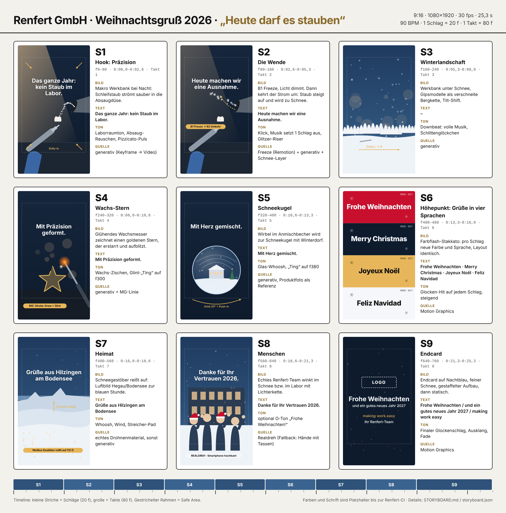

# Storyboard: Weihnachtsgruß 2026 – Renfert GmbH

**Arbeitstitel:** „Heute darf es stauben“
**Format:** 9:16 · 1080×1920 · 30 fps · **25,3 s** (760 Frames) · Social Media (Instagram Reels, LinkedIn, TikTok, YouTube Shorts, Facebook)
**Umsetzung:** generative Clips (Higgsfield) + Motion Graphics (Remotion, Claude Code) + Lizenzmusik und SFX, automatisiert geschnitten nach [`storyboard.json`](storyboard.json)
**Grammatik:** Schnitt-, Easing- und Safe-Area-Regeln aus [`motion-spec/STIL_UND_ANIMATIONSVORGABE.md`](../motion-spec/STIL_UND_ANIMATIONSVORGABE.md)

---

## 1. Idee

Renfert sorgt das ganze Jahr dafür, dass im Dentallabor **kein Staub** in der Luft
liegt. Einmal im Jahr machen wir eine Ausnahme: Die Absaugung läuft rückwärts,
aus Gipsstaub wird Schnee, und das Labor verwandelt sich in eine Winterlandschaft.
Typische Laborarbeit wird dabei zum Weihnachtsmotiv:

| Laboralltag | wird zu … |
|---|---|
| Schleifstaub an der Absaugung | Schneeflocken |
| Gipsmodelle auf der Werkbank | verschneite Bergkette (Augenzwinkern Richtung Hegau) |
| Wachsmesser und Modellierwachs | goldener Weihnachtsstern |
| Anmischbecher im Vakuum-Mischgerät | Schneekugel mit Winterdorf |
| Labor in Hilzingen | Luftbild Hegau / Bodensee im Schnee |

Der Ton ist **warm, präzise, mit einem Augenzwinkern**. Zielgruppe sind
Zahntechniker:innen, Labore, Praxen, Handelspartner und das eigene Team. Fachleute
erkennen die Anspielungen sofort; alle anderen sehen einen stimmungsvollen
Winterfilm.

**Dramaturgie in einem Satz:** Präzision (kühl, ruhig) → Stopp → Magie (warm,
Schnee) → Höhepunkt (Grüße in vier Sprachen) → Weite (Heimatregion) → Menschen
(echtes Team) → Logo.

---

## 2. Eckdaten

| Parameter | Wert |
|---|---|
| Master | 1080×1920, 30 fps, H.264, ca. 16 Mbit/s, AAC 48 kHz |
| Länge | 760 f = 25,33 s (Hauptfassung) · 420 f = 14,0 s (Kurzfassung) |
| Musikraster | **90 BPM**, 4/4 → 1 Schlag = **20 f**, 1 Takt = **80 f** (2,67 s) |
| Szenen | 8 Szenen à 1 Takt + Endcard 1,5 Takte (120 f) |
| Schnitt | harte Schnitte auf dem Downbeat, Szenenwechsel **2 f vor dem Beat** (Motion-Spec 1.2) |
| Safe Area | oben 180 px, unten 320 px, seitlich 60 px frei von Text |
| Ton | sound-off-tauglich: alle Aussagen stehen als Text im Bild, kein Voice-over nötig |
| Lautheit | −14 LUFS integriert, True Peak −1 dBTP |
| Sprachen | DE (Hauptfassung), EN (zweite Fassung, nur Texte getauscht) |

---

## 3. Look

**Licht und Farbe.** Kühle, tiefblaue Schatten (blaue Stunde) gegen warmes
Arbeitslicht (ca. 3200 K) und Goldakzente. Fotorealistisch, Makro, geringe
Schärfentiefe, feines Filmkorn. Kein Kitsch-Rot-Grün; Weihnachten entsteht über
Schnee, Licht und Gold.

**Farb-Tokens** (Platzhalter, bis die Renfert-CI-Werte eingetragen sind):

| Token | Hex | Einsatz |
|---|---|---|
| `night` | `#0E1B2C` | Hintergrund Endcard, Schatten-Grade, Flash 2 |
| `snow` | `#F5F7FA` | Text auf Footage, Flash 4 |
| `gold` | `#E8B65A` | Stern, Akzentlinien, Flash 3 (Text schwarz) |
| `brand_primary` | **aus CI-Manual** | Flash 1, Logo-Fläche (Platzhalter im Sheet: `#C8102E`) |
| `ink` | `#121212` | Text auf Gold und Weiß |

**Typografie.** Hausschrift laut CI-Manual. Bis dahin: Inter (Bold 700 für
Headlines, Medium 500 für Unterzeilen). Headline 96–120 px, Unterzeile mindestens
56 px bei 1080 px Breite. Text auf Footage weiß mit weichem Schatten
(`0 4px 24px rgba(0,0,0,.35)`).

**Logo und Produkte.** Das Renfert-Logo kommt **ausschließlich als Vektor-Overlay**
in Motion Graphics ins Bild, nie aus einem generativen Modell. Produkte (Absaugung,
Wachsmesser, Mischgerät) entweder als Nahaufnahme ohne Logo und Typenschild oder
über **echte Produktfotos als Bildreferenz** (image-to-video), damit keine
erfundenen Gerätedetails entstehen.

---

## 4. Shotliste

Zeitangaben in Frames @30 fps und in Sekunden. „B“ = Schlag im Takt.

### S1 · Hook: Präzision · f0–80 · 0:00,0–0:02,7

| | |
|---|---|
| **Bild** | Makro, Werkbank im Labor bei Nacht. Behandschuhte Hand schleift eine Zirkonkrone, feiner weißer Staub strömt sauber und gegenlichtig in eine Absaugdüse oben rechts. Kühles Blau, ein warmes Arbeitslicht. |
| **Kamera** | langsamer Dolly-in, leichte Parallaxe |
| **Text** | ab f6, wortweise: **„Das ganze Jahr: kein Staub im Labor.“** |
| **Ton** | Laborraumton, leises Absaug-Rauschen; Musik minimal (Pizzicato, tickender Puls) |
| **Quelle** | generativ (Keyframe-Bild → Video) |
| **Zweck** | Hook in der ersten Sekunde: ungewöhnliches Makro und klare Behauptung |

### S2 · Die Wende · f80–160 · 0:02,7–0:05,3

| | |
|---|---|
| **Bild** | B1: **Freeze.** Staubpartikel stehen in der Luft, Licht dimmt leicht. B2–B4: Der Strom kehrt sich um, Partikel steigen aus der Düse und werden zu glitzernden Schneeflocken. |
| **Kamera** | statisch |
| **Text** | ab f84: **„Heute machen wir eine Ausnahme.“** |
| **Ton** | f80 Schalter-Klick, Absaugung fährt herunter, **Musik setzt einen Schlag aus** (Stille = Spannung); ab f100 aufsteigender Glitzer-Riser |
| **Quelle** | Freeze als Standbild in Remotion (20 f), danach generativer Umkehr-Clip, Schnee-Partikel-Layer als MG-Overlay |

### S3 · Winterlandschaft · f160–240 · 0:05,3–0:08,0

| | |
|---|---|
| **Bild** | Die Werkbank liegt unter frischem Schnee. Eine Reihe weißer Gipsmodelle (Oberkiefer) steht wie eine verschneite Bergkette, kleine Instrumente halb im Schnee, Schneefall, warmes Licht im Bokeh. Miniatur-/Tilt-Shift-Anmutung. |
| **Kamera** | seitlicher Dolly links → rechts entlang der „Bergkette“ |
| **Text** | keiner (Bild wirken lassen) |
| **Ton** | **f160 Downbeat: volle Musik** mit Schlittenglöckchen und Celesta, weiches Schnee-„Puff“ |
| **Quelle** | generativ |

### S4 · Wachs-Stern · f240–320 · 0:08,0–0:10,7

| | |
|---|---|
| **Bild** | Glühende Spitze eines elektrischen Wachsmessers. Goldenes Modellierwachs fließt und zeichnet in einem Zug einen fünfzackigen Stern, der erstarrt und aufblitzt. |
| **Kamera** | Makro, statisch mit leichtem Push-in |
| **Text** | ab f246: **„Mit Präzision geformt.“** |
| **MG** | goldene Linie zeichnet den Stern nach (Stroke-Draw, 30 f, `expo_out`), Glint auf B4 (f300) |
| **Ton** | leises Wachs-Zischen, Glitzer-„Ting“ auf f300 |
| **Quelle** | generativ + MG-Overlay |

### S5 · Schneekugel · f320–400 · 0:10,7–0:13,3

| | |
|---|---|
| **Bild** | Transparenter Anmischbecher von schräg oben. Der weiße Wirbel im Becher wird zur Schneekugel: Flocken kreisen um ein Miniatur-Winterdorf mit kleinem Firmengebäude und geschmücktem Tannenbaum, warme Fenster. |
| **Kamera** | Orbit ca. 20°, dann Push-in Richtung Glas, die letzten 8 f beschleunigt (`whip_in`) in den harten Schnitt auf S6 |
| **Text** | ab f326: **„Mit Herz gemischt.“** |
| **Ton** | gläsernes Wirbel-Whoosh, „Ting“ am Glas auf f380 |
| **Quelle** | generativ, Becher über echtes Produktfoto als Referenz |

### S6 · Höhepunkt: Grüße in vier Sprachen · f400–480 · 0:13,3–0:16,0

| | |
|---|---|
| **Bild** | Farbflash-Stakkato (Motion-Spec 1.2 / 5.5.6): identisches Layout, pro Schlag (20 f) neue Hintergrundfarbe und Sprache. Kleine Schneeflocken-Ornamente springen gestuft mit 8 fps. |
| **Folge** | f400 `brand_primary` „Frohe Weihnachten“ · f420 `night` „Merry Christmas“ · f440 `gold` „Joyeux Noël“ (Text schwarz) · f460 `snow` „Feliz Navidad“ (Text schwarz) |
| **Text** | jeweils hart an, ohne Tween; nur der erste Flash mit Pop (`back_out`, 6 f) |
| **Ton** | Glocken-Hit auf jedem Schlag, Tonhöhe steigt |
| **Quelle** | reine Motion Graphics (Remotion) |
| **Zweck** | internationaler Gruß (Renfert verkauft in über 120 Länder), Thumbnail-Kandidat |

### S7 · Heimat · f480–560 · 0:16,0–0:18,7

| | |
|---|---|
| **Bild** | Aus dem weißen letzten Flash wird dichtes Schneegestöber, das in 12 f aufreißt und ein Luftbild freigibt: verschneiter Hegau zur blauen Stunde, Vulkankegel, Dorf mit warmen Lichtern, am Horizont der Bodensee. |
| **Kamera** | Drohne steigt und zieht langsam zurück; startet in Bewegung (`expo_out`) bei 115 % Scale |
| **Text** | ab f490: **„Grüße aus Hilzingen am Bodensee“** |
| **Ton** | Whoosh beim Aufreißen des Schneegestöbers, Wind, Musik öffnet sich (Streicher-Pad) |
| **Quelle** | **bevorzugt echtes Drohnenmaterial** (Archiv/Stock); sonst generativ |

### S8 · Menschen · f560–640 · 0:18,7–0:21,3

| | |
|---|---|
| **Bild** | Das echte Renfert-Team, z. B. vor dem Gebäude im Schnee oder im Labor mit Lichterkette, winkt in die Kamera. Gern Mützen, Tassen, ehrliche Stimmung. |
| **Kamera** | Smartphone hochkant, 4K/30 fps, statisch oder langsamer Push-in, 5–8 s drehen |
| **Text** | ab f566: **„Danke für Ihr Vertrauen 2026.“** |
| **Ton** | optional echtes „Frohe Weihnachten!“ vom Team (mit dem Handy aufnehmen) |
| **Quelle** | **Realdreh, kein generatives Material.** Echte Menschen statt generierter Gesichter, die „unser Team“ darstellen würden |
| **Fallback** | generativ ohne Gesichter: Hände stoßen mit Tassen über einer Werkbank mit Lichterkette an; Text dann „Danke für ein starkes Jahr 2026.“ |

### S9 · Endcard · f640–760 · 0:21,3–0:25,3

| | |
|---|---|
| **Bild** | Harter Schnitt auf `night`, feiner Schneefall-Layer (einzige Bewegung). Gestaffelter Aufbau, danach statisch (Motion-Spec 1.2: Endcard 3,2–4,2 s). |
| **Aufbau** | f640 Logo (Pop, `back_out`, 6 f) · f646 „Frohe Weihnachten“ · f649 „und ein gutes neues Jahr 2027“ · f657 Claim „making work easy“ (`gold`) · f660 „Ihr Renfert-Team“ |
| **Ton** | finaler Glockenschlag auf f640, Schlussakkord klingt aus, Musik-Fade f740–760 |
| **Quelle** | Motion Graphics |

---

## 5. Texte

| Key | DE | EN |
|---|---|---|
| `s1` | Das ganze Jahr: kein Staub im Labor. | All year long: no dust in the lab. |
| `s2` | Heute machen wir eine Ausnahme. | Today we make an exception. |
| `s4` | Mit Präzision geformt. | Shaped with precision. |
| `s5` | Mit Herz gemischt. | Mixed with heart. |
| `s6` | Frohe Weihnachten · Merry Christmas · Joyeux Noël · Feliz Navidad | Merry Christmas · Frohe Weihnachten · Joyeux Noël · Feliz Navidad |
| `s7` | Grüße aus Hilzingen am Bodensee | Greetings from Hilzingen, Lake Constance |
| `s8` | Danke für Ihr Vertrauen 2026. | Thank you for your trust in 2026. |
| `end_1` | Frohe Weihnachten | Merry Christmas |
| `end_2` | und ein gutes neues Jahr 2027 | and a happy New Year 2027 |
| `claim` | making work easy | making work easy |
| `sign` | Ihr Renfert-Team | Your Renfert Team |

**Alternativen für S1/S2**, falls der Staub-Witz nicht gewünscht ist:
„Das ganze Jahr arbeiten wir präzise …“ / „… heute arbeiten wir mit Zauber.“

**Post-Text (Vorschlag)**
- DE: *Einmal im Jahr darf es bei uns im Labor schneien. ❄️ Danke für Ihr Vertrauen 2026 – wir wünschen Ihnen frohe Weihnachten und ein gutes neues Jahr! Ihr Team aus Hilzingen. #Renfert #makingworkeasy #Zahntechnik #DentalLab #FroheWeihnachten*
- EN: *Once a year, we let it snow in the lab. ❄️ Thank you for your trust in 2026 – Merry Christmas and a happy New Year from all of us in Hilzingen! #Renfert #makingworkeasy #DentalTechnology #DentalLab #MerryChristmas*

---

## 6. Sound

**Musik-Briefing** (Lizenzmusik, z. B. Artlist, Epidemic Sound, Musicbed; Social-Media-Lizenz für Firmenkanäle nötig):
- 90 BPM, 4/4, D-Dur, warm und modern-weihnachtlich
- Pizzicato-Streicher, Celesta/Glockenspiel, Schlittenglöckchen, Felt-Piano, ab Takt 3 leichte Fingersnaps
- **keine bekannte Weihnachtsmelodie, kein Gesang** (Rechte, internationale Nutzbarkeit)
- Suchbegriffe: „warm corporate christmas pizzicato“, „magical winter celesta 90 bpm“

**Struktur auf dem Raster**

| Takt | Frames | Musik |
|---|---|---|
| 1 | 0–80 | Intro: Pizzicato-Puls, sehr reduziert |
| 2 | 80–160 | Schlag 1 Stille (Stopp), ab Schlag 2 Riser/Glitzer |
| 3–5 | 160–400 | Hauptteil, volle Instrumentierung |
| 6 | 400–480 | Höhepunkt, Glocken-Hits auf jedem Schlag |
| 7 | 480–560 | Öffnung: Streicher-Pad, Drums raus |
| 8 | 560–640 | warm, Rückkehr des Themas |
| 9–9,5 | 640–760 | Schlussakkord mit Glocke, Ausklang, Fade ab f740 |

Die Musik wird auf 25,33 s geschnitten (Edit am Taktende von Takt 8 auf ein
Schlussstück). Beat-Positionen danach mit `tools/analyze_motion.py` bzw. einer
Onset-Analyse gegen das Raster prüfen.

**SFX-Cues**

| Frame | Cue |
|---|---|
| 0 | Raumton Labor, Absaug-Rauschen (leise, läuft bis 80) |
| 80 | Schalter-Klick, Absaugung fährt herunter |
| 100 | Glitzer-Riser (bis 160) |
| 160 | weiches Schnee-„Puff“ |
| 250 | Wachs-Zischen (leise) |
| 300 | Glint-„Ting“ |
| 330 | gläsernes Wirbel-Whoosh |
| 380 | Glas-„Ting“ |
| 400 / 420 / 440 / 460 | Glocken-Hits, steigende Tonhöhe |
| 476 | Schneegestöber-Whoosh (bis 492) |
| 480 | Wind, leise |
| 566 | optional: Team ruft „Frohe Weihnachten!“ |
| 640 | finaler Glockenschlag, Logo-Glitzer |

**Mix:** Musik als Bett, SFX dezent (Musik −3 dB unter SFX-Spitzen nur bei f80,
f400–460, f640). Kein Voice-over.

---

## 7. Produktions-Pipeline

1. **Brand-Assets bereitstellen** (siehe Abschnitt 9) unter `weihnachtsgruss-2026/assets/`.
2. **Keyframes** je generativer Szene erzeugen (Higgsfield, `nano_banana_pro` oder
   `cinematic_studio_2_5`, 9:16, 2K). Produkt-Szenen mit echtem Produktfoto als
   Bildreferenz. Freigabe der Keyframes vor dem Video-Schritt spart Credits.
3. **Image-to-Video** (`seedance_2_0`, 1080p, 5 s, `generate_audio: false`; Luftbild
   alternativ `cinematic_studio_3_0`). Pro Szene 2–3 Varianten, besten Take wählen.
   Generiert wird länger als nötig (5 s statt 2,67 s); im Schnitt werden die besten
   80 Frames genommen (`take_hint` in der JSON).
   Hinweis: Der in dieser Claude-Code-Session verbundene Higgsfield-Connector kann
   Modelle lesen und Ergebnisse importieren, aber **nicht generieren**. Generieren
   läuft über die Higgsfield-Web-App oder die API.
4. **Realdreh S8** (Team, Smartphone hochkant) und ggf. Drohnenmaterial S7.
5. **Schnitt und Motion Graphics** in Remotion: Timeline, Texte, Flash-Stakkato,
   Stern-Linie, Schnee-Layer und Endcard werden direkt aus `storyboard.json`
   gebaut. 24-fps-Clips werden auf 30 fps konform gesetzt.
6. **Grade:** einheitlich kühle Schatten / warme Lichter, feines Korn über alles,
   damit generative und reale Clips zusammenpassen.
7. **Ton:** Musik-Edit, SFX nach Cue-Liste, Mix auf −14 LUFS.
8. **Render** DE + EN, Haupt- und Kurzfassung, Cover-Frame.
9. **QC** (Abschnitt 8).

**Kurzfassung (14,0 s):** S1 → S2 → S5 → S6 → S9 (Endcard auf 100 f gekürzt).
Braucht einen eigenen Musik-Edit.

**Cover/Thumbnail:** S6, Frame 405 („Frohe Weihnachten“ auf `brand_primary`) oder
Endcard-Frame 700.

---

## 8. Abnahme-Checkliste

- [ ] Alle Schnitte liegen auf dem 20-f-Raster (±1 f), Szenenwechsel max. 2 f vor dem Beat
- [ ] Kein Text in den Safe-Area-Rändern (oben 180, unten 320, seitlich 60 px)
- [ ] Jede Texteinblendung steht mindestens 1,5 s (lesbar ohne Ton); Ausnahme: Flash-Stakkato S6
- [ ] Keine erfundenen Logos, Schriftzüge oder Typenschilder im generativen Material
- [ ] Produkte korrekt dargestellt oder bewusst ohne erkennbare Details
- [ ] S8 zeigt echte Mitarbeitende; Einverständnis zur Veröffentlichung liegt vor
- [ ] Musiklizenz deckt Social Media / Firmenkanäle ab
- [ ] KI-Kennzeichnung der Plattformen gesetzt (Instagram/Facebook „KI-Info“, TikTok „AI-generated“), weil realistische KI-Szenen enthalten sind
- [ ] Lautheit −14 LUFS, True Peak ≤ −1 dBTP
- [ ] Endcard 4 s statisch, Logo in CI-Farben und Schutzzone

---

## 9. Offene Punkte (bitte von Renfert liefern bzw. bestätigen)

1. **Logo** als SVG (positiv und negativ) sowie CI-Farben und Hausschrift → ersetzen die Platzhalter-Tokens
2. **Schreibweise des Claims** „making work easy“ (Klein-/Großschreibung, Einsatz in Bewegtbild)
3. **Produktfotos** (freigestellt) von Absaugung, elektrischem Wachsmesser und Anmischbecher/Mischgerät als Referenz
4. **Teamvideo S8** (oder Freigabe für den Fallback ohne Gesichter)
5. **Drohnen-/Luftbild** Hilzingen/Hegau im Winter, falls vorhanden
6. Freigabe der **Texte** und des Staub-Witzes durch Marketing
7. Wunsch-**Plattformen** und ob die EN-Fassung benötigt wird
